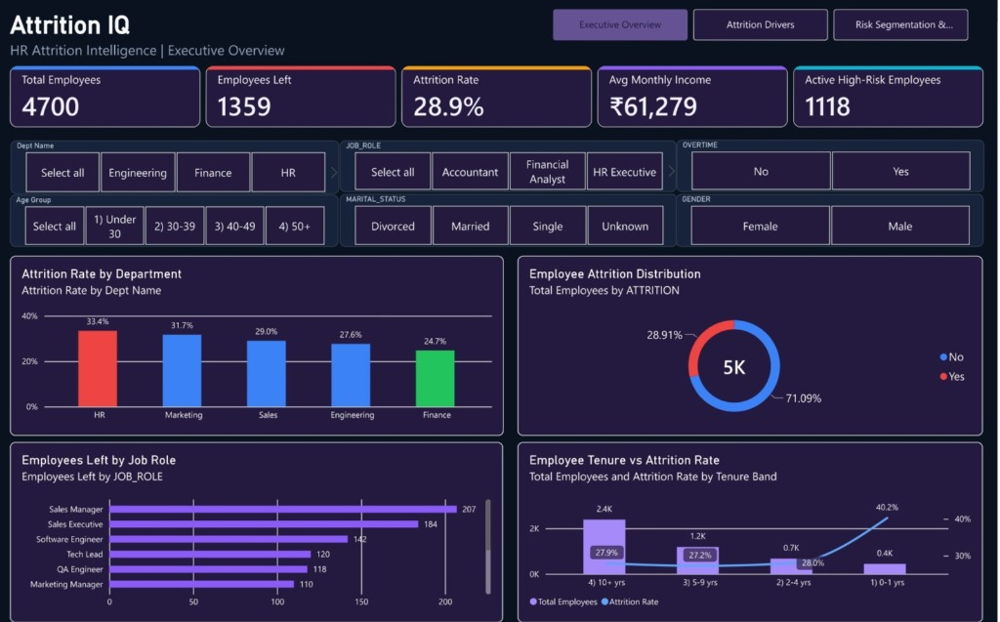
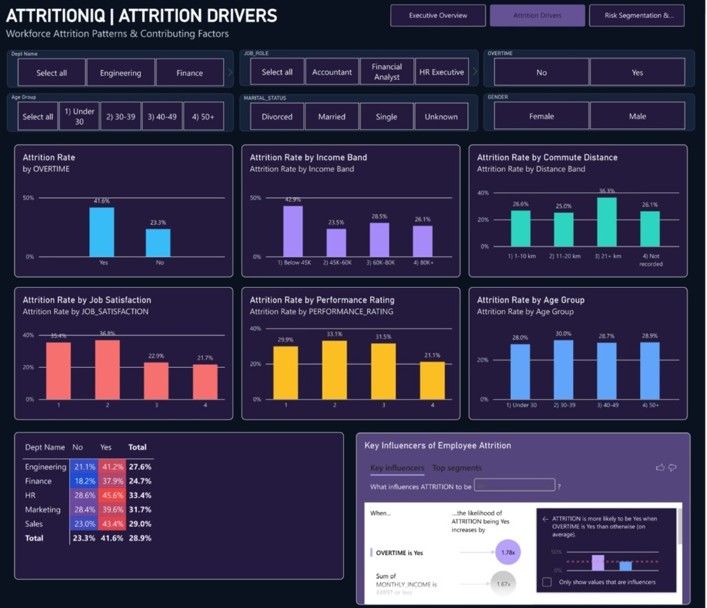
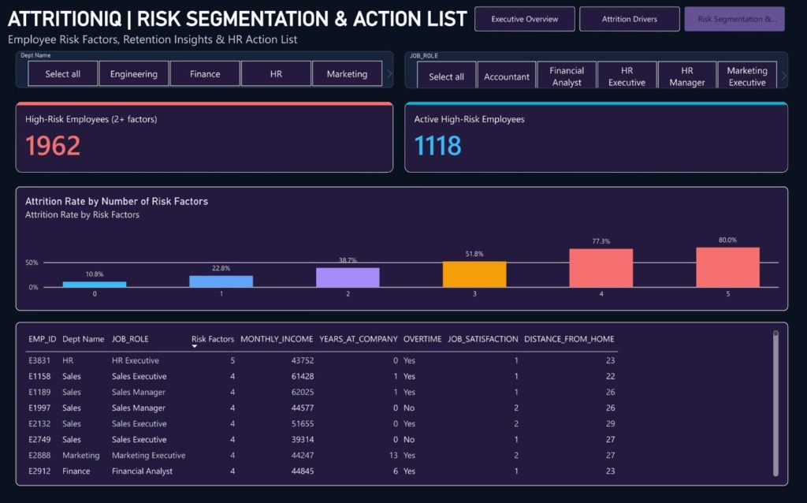

# 🏢 AttritionIQ — Executive HR Workforce Intelligence Dashboard (Power BI)

[](https://powerbi.microsoft.com/)
[](https://learn.microsoft.com/en-us/dax/)
[](https://www.snowflake.com/)
[](https://hr-attrition-iq-fz7cy8ubamq9xq3jff4qib.streamlit.app/)

An executive-level **Power BI Workforce Intelligence & Employee Retention Dashboard** designed to transform complex employee demographic, performance, and tenure data into high-impact visual retention strategies. 

This project explores workforce attrition patterns across 4,700 employee records, isolates key exit drivers through multi-factor risk segmentation, and provides an actionable operational framework for HR business partners and executive leadership.

---

## 📌 Executive Summary & Key KPIs

Across an analyzed enterprise workforce of **4,700 employees**, **1,359 departures** were recorded, representing an overall attrition rate of **28.9%**. 

```text
┌──────────────────────┬──────────────────────┬──────────────────────┬──────────────────────┬──────────────────────┐
│   Total Employees    │    Employees Left    │    Attrition Rate    │  Avg Monthly Income  │ Active High-Risk Emp │
│        4,700         │        1,359         │        28.9%         │       ₹61,279        │        1,118         │
└──────────────────────┴──────────────────────┴──────────────────────┴──────────────────────┴──────────────────────┘
```

* **Overall Headcount:** 4,700 employees across 5 core departments.
* **Workforce Stability:** 71.09% retention rate (3,341 active employees) vs. 28.91% attrition.
* **Baseline Compensation:** Average monthly income of ₹61,279 across all roles.
* **Proactive Risk Intervention:** **1,118 active, retained employees** currently exhibit 2 or more combined flight-risk indicators, providing a targeted intervention list for HR teams to prevent future turnover.

---

## 🖥️ Dashboard Architecture & Views

The Power BI report (`AttritionIQ_HR_Attrition_Intelligence_Final.pbix`) is structured into three specialized analytical perspectives:

1. **Executive Overview** — High-level workforce composition, department-level risk, and tenure trends.
2. **Attrition Drivers** — Root-cause discovery across workload, compensation, commute, satisfaction, and performance.
3. **Risk Segmentation & Action List** — Multi-factor scoring model that isolates active high-risk employees for immediate retention outreach.

---

### 1. Executive Overview

A high-level command center providing leadership with total workforce health metrics, department comparisons, retention mix, and tenure curve analysis.



#### Key Highlights & Observations:
* **Department Attrition Disparity:**
  * **Human Resources:** Highest observed attrition rate at **33.4%**.
  * **Marketing:** Elevated turnover at **31.7%**.
  * **Sales:** Steady high exit rate at **29.0%**.
  * **Engineering:** **27.6%** exit rate.
  * **Finance:** Highest relative stability with **24.7%** attrition.
* **Exits by Role:** Turnover volume is highest in front-line revenue and technical execution roles (**Sales Managers: 207 exits**, **Sales Executives: 184 exits**, **Software Engineers: 142 exits**, **Tech Leads: 120 exits**).
* **Early-Tenure Retention Cliff:** Employees in their **first year (0–1 years)** experience a severe attrition spike of **40.2%**, compared to **27.2% – 28.0%** for tenures of 2+ years.

---

### 2. Attrition Drivers & Contributing Factors

An interactive exploratory view that isolates organizational and environmental factors contributing to employee exits.



#### Critical Risk Factor Findings:
* **Overtime Workload Impact:** Employees working overtime experience an attrition rate of **41.6%**, compared to only **23.3%** for non-overtime staff — a **1.78× increase** in exit likelihood.
* **Compensation Sensitivity:** Staff earning below ₹45,000/month display an attrition rate of **42.9%**, nearly double the rate of staff in the ₹45,000–₹60,000 bracket (**23.5%**).
* **Commute Friction:** Staff with long commutes (**21+ km**) leave at **36.3%**, compared to **~25%** for staff residing closer to the office.
* **Job Satisfaction Sensitivity:** Employees rating satisfaction at Level 1 (**35.4%**) and Level 2 (**36.8%**) exit at significantly higher frequencies than those at Level 3 (**22.9%**) and Level 4 (**21.7%**).
* **Performance Rating Balance:** Retention challenges are prevalent across both standard performers and high contributors when paired with burnout or compensation dissatisfaction.

---

### 3. Risk Segmentation & Retention Action List

A tactical, employee-level operational dashboard that categorizes staff by cumulative risk factor count and outputs an actionable intervention list.



#### Multi-Factor Risk Framework:
Risk factors are assigned based on empirical attrition thresholds:
1. **Workload:** `Overtime = "Yes"`
2. **Compensation:** `Monthly Income < ₹45,000`
3. **Commute:** `Distance From Home ≥ 21 km`
4. **Morale:** `Job Satisfaction ≤ 2`
5. **Early Tenure:** `Years At Company ≤ 1 year`

#### Cumulative Risk Escalation:
```text
  Risk Factor Count  │  Observed Attrition Rate  │  Risk Category
─────────────────────┼───────────────────────────┼────────────────────
      0 Factors      │           10.8%           │  Low Risk
      1 Factor       │           22.8%           │  Moderate Risk
      2 Factors      │           38.7%           │  High Risk
      3 Factors      │           51.8%           │  Severe Risk
      4 Factors      │           77.3%           │  Critical Risk
      5 Factors      │           80.0%           │  Imminent Risk
```

* **Action List Table:** Displays specific active employees (Employee ID, Department, Role, Monthly Income, Tenure, Overtime, Job Satisfaction, Commute Distance) who have 2+ risk indicators so HR business partners can conduct targeted, confidential 1-on-1 check-ins.

---

## 📐 Data Modeling & DAX Measures

The data model uses clean star-schema principles, connecting fact records with dynamic dimension slicers and optimized DAX measures:

### Core DAX Measures

#### 1. Total Headcount
```dax
Total Employees = COUNTROWS('hr_attrition_final')
```

#### 2. Departures Count
```dax
Employees Left = 
CALCULATE(
    COUNTROWS('hr_attrition_final'),
    'hr_attrition_final'[ATTRITION] = "Yes"
)
```

#### 3. Active Employees
```dax
Active Employees = 
CALCULATE(
    COUNTROWS('hr_attrition_final'),
    'hr_attrition_final'[ATTRITION] = "No"
)
```

#### 4. Attrition Rate (%)
```dax
Attrition Rate = 
DIVIDE(
    [Employees Left],
    [Total Employees],
    0
)
```

#### 5. Retention Rate (%)
```dax
Retention Rate = 1 - [Attrition Rate]
```

#### 6. Multi-Factor Risk Score (Calculated Column)
```dax
Risk_Factors = 
VAR OvertimeRisk = IF('hr_attrition_final'[OVERTIME] = "Yes", 1, 0)
VAR IncomeRisk = IF('hr_attrition_final'[MONTHLY_INCOME] < 45000, 1, 0)
VAR CommuteRisk = IF('hr_attrition_final'[DISTANCE_FROM_HOME] >= 21, 1, 0)
VAR SatisfactionRisk = IF('hr_attrition_final'[JOB_SATISFACTION] <= 2, 1, 0)
VAR TenureRisk = IF('hr_attrition_final'[YEARS_AT_COMPANY] <= 1, 1, 0)
RETURN
    OvertimeRisk + IncomeRisk + CommuteRisk + SatisfactionRisk + TenureRisk
```

#### 7. Active High-Risk Employees Count
```dax
Active High-Risk Employees = 
CALCULATE(
    COUNTROWS('hr_attrition_final'),
    'hr_attrition_final'[ATTRITION] = "No",
    'hr_attrition_final'[Risk_Factors] >= 2
)
```

---

## 💡 Strategic HR Recommendations

Based on the quantitative findings in the dashboard, the following data-driven retention initiatives are recommended:

1. **Targeted First-Year Onboarding:** With first-year turnover peaking at **40.2%**, implement structured 30-60-90 day check-ins, mentorship pairing, and manager alignment meetings to bridge the early-tenure engagement gap.
2. **Overtime Auditing & Workload Rebalancing:** Overtime increases exit rates from 23.3% to **41.6%**. Department managers should monitor cumulative extra hours, enforce compensatory time off, and review headcount capacity in Sales and Technical teams.
3. **Bottom-Quartile Compensation Adjustments:** Address the ₹45,000 threshold where attrition spikes to **42.9%** through market-aligned salary benchmarking, retention bonuses, and clear promotion timelines.
4. **Commute Flexibility & Hybrid Work:** Employees traveling **21+ km** show an attrition rate of **36.3%**. Introducing 2–3 remote work days per week can directly reduce commute fatigue and improve retention.
5. **Proactive Intervention on Active High-Risk Staff:** Leverage the **Active High-Risk Action List (1,118 employees)** to conduct structured, empathetic stay-interviews before employees decide to initiate external job searches.

---

## 🗂️ Repository Structure

```text
HR-Attrition-PowerBI-Dashboard/
│
├── AttritionIQ_HR_Attrition_Intelligence_Final.pbix   # Complete Power BI Report file
│
├── data/
│   └── hr_attrition_final.csv                         # 4,700-row cleaned workforce dataset
│
├── assets/
│   └── screenshots/
│       ├── executive-overview.jpg                     # Executive Overview Dashboard view
│       ├── attrition-drivers.jpg                      # Attrition Drivers view
│       └── risk-segmentation-action-list.jpg          # Risk Segmentation & Action List view
│
├── .gitignore                                         # Optimized Git ignores for Power BI
└── README.md                                          # Executive documentation & report guide
```

---

## 🚀 How to Open and Explore the Dashboard

### Prerequisites
* [Power BI Desktop](https://powerbi.microsoft.com/desktop/) (Free download from Microsoft, Windows 10/11)

### Steps
1. **Clone or Download the Repository:**
   ```bash
   git clone https://github.com/yashchaudhari372-lab/HR-Attrition-PowerBI-Dashboard.git
   ```
2. **Open the Report:**
   * Double-click `AttritionIQ_HR_Attrition_Intelligence_Final.pbix` to launch the dashboard in Power BI Desktop.
3. **Data Refresh (Optional):**
   * If you wish to connect the report to the bundled CSV file on your local machine:
     1. In Power BI Desktop, click **Transform Data** > **Data source settings**.
     2. Update the file path to point to your local `data/hr_attrition_final.csv`.
     3. Click **Close & Apply**.
4. **Interact with Filters:**
   * Use the top multi-select slicers (Department, Job Role, Age Group, Marital Status, Gender, Overtime) to explore dynamic cross-filtering across all visual cards and charts.

---

## 🔗 Related Projects & Live Machine Learning App

This Power BI analytics project is paired with an end-to-end Machine Learning web platform:

* 🤖 **Machine Learning & Streamlit Repository:** [HR-Attrition-IQ on GitHub](https://github.com/yashchaudhari372-lab/HR-Attrition-IQ)
* 🌐 **Live Interactive Streamlit App:** [Open HR Attrition IQ](https://hr-attrition-iq-fz7cy8ubamq9xq3jff4qib.streamlit.app/)
  * *Features: Snowflake cloud warehouse connectivity, Random Forest ML attrition predictor, interactive Plotly visualizations, executive PDF/Excel report generator, and offline zero-downtime fallback.*

---

## 👤 Author & Portfolio

**Yash Chaudhari**  
*Aspiring Data Scientist & Business Intelligence Analyst*  
*Specializing in Power BI, SQL, Python, Snowflake, and Machine Learning*

* 🌐 **Portfolio Website:** [yash-portfolio](https://github.com/yashchaudhari372-lab/yash-portfolio)  
* 🐙 **GitHub Profile:** [@yashchaudhari372-lab](https://github.com/yashchaudhari372-lab)  
* 📧 **Email:** [Yashchaudhari372@gmail.com](mailto:Yashchaudhari372@gmail.com)

---

*If you find this project valuable, consider giving this repository a ⭐ to support the work!*
